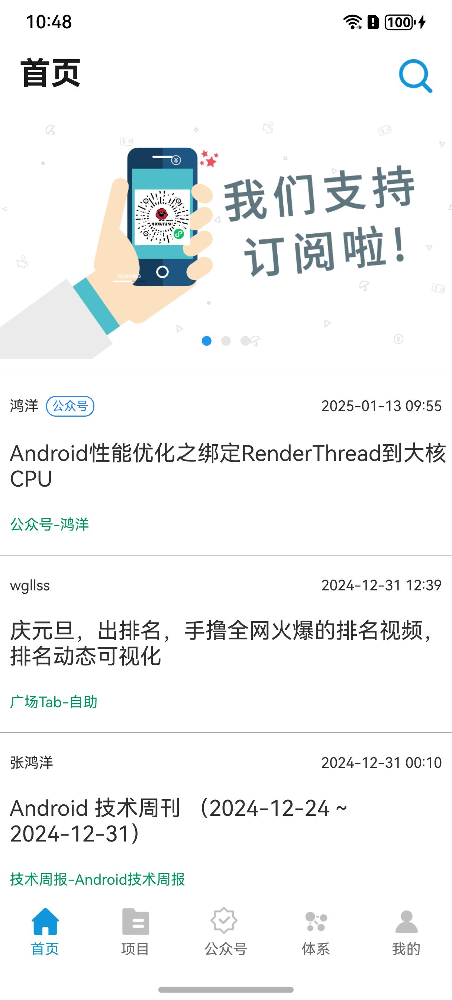
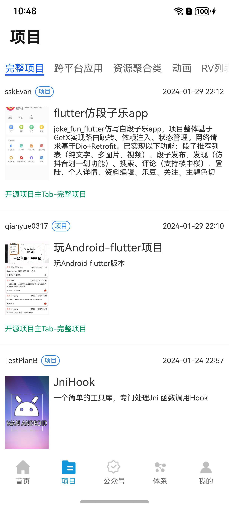
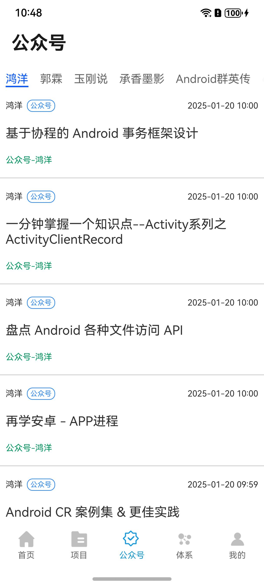
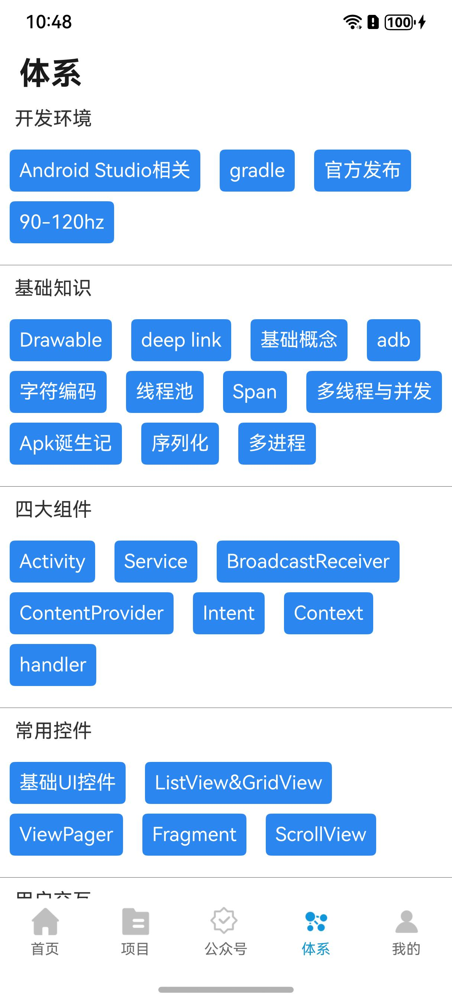
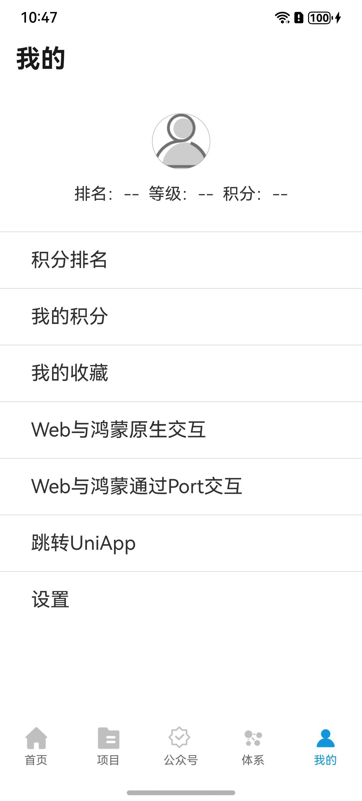

# HarmonyOS开发wandroid客户端项目实践

## 写在前面

作为一名移动端开发者，我一直在探索**如何在不同平台上构建高质量的应用**。

过去几年，我陆续开发了三个基于 WanAndroid API 的客户端项目：iOS 版（RxSwift + MVVM）、Android 版（GetX + GetController）、跨平台版（Vue3 + UniApp）。

如今，随着移动端的势微以及内卷，我终于向着~~全栈~~（全干）迈进，于是我开始了一个新的开源项目**HarmonyStudy** - 一个基于 ArkTS + ArkUI 的HarmonyOS 客户端开发。

|  |  |  |  |  |
| :----------------------------------------------------------: | :----------------------------------------------------------: | :----------------------------------------------------------: | :----------------------------------------------------------: | :----------------------------------------------------------: |
|                             首页                             |                             项目                             |                            公众号                            |                             体系                             |                             我的                             |

**这个项目最早始于2024年中，我需要开始在日常工作落地纯血HarmonyOS项目而始，目前已经尝试适配到HarmonyOS Next 6，当然里面有很多不足和过期的API我也找抽空进行学习与优化，希望大家多多包容与海涵！**

**如果你对其他平台的WanAndroid开发感兴趣，也可以看看下面表格中其他端的项目：**

| [Swift版](https://github.com/seasonZhu/RxStudy) | [Android版](https://github.com/seasonZhu/GetXStudy) | [UniApp版](https://github.com/seasonZhu/UniAppPlayAndroid) |
| ----------------------------------------------- | ------------------------------------------------------------ | ---------------------------------------------------------- |

本系列将分享我选择纯血HarmonyOS开发的思考、架构设计以及开发实践，这篇文章是一个整体的介绍。

---

## 一、为什么选择 WanAndroid API？

在Android技术圈，[WanAndroid API](https://www.wanandroid.com/blog/show/2) 几乎是开发者的"练手标配"。选择它作为项目 API，我有以下考虑：

### 1.1 API 设计规范，功能完整

WanAndroid API 涵盖了一个成熟 APP 应具备的大部分功能：
- ✅ 用户系统（登录、注册、积分、排行）
- ✅ 内容展示（首页、项目、公众号、体系）
- ✅ 文章系统（列表、详情、收藏）
- ✅ 搜索功能（热词、实时搜索、历史记录）
- ✅ 交互体验（下拉刷新、上拉加载）

### 1.2 便于验证框架能力

使用同一套 API，可以专注于**HarmonyOS平台框架的探索**，验证各种功能的实现效果；同时也可以将以往的在不同平台开发的经验迁移过来，对比异同。

---

## 二、HarmonyOS Next技术选型

### 2.1 技术栈确定

```
┌─────────────────────────────────────┐
│         ArkTS (开发语言)             │
│   - 类型安全 - 静态类型检查          │
│   - 协程支持 - 简洁的异步编程        │
│   - 方舟编译 - 高效运行             │
├─────────────────────────────────────┤
│         ArkUI (UI 框架)              │
│   - 声明式 UI - 数据驱动渲染         │
│   - 组件化 - 高度复用               │
│   - Navigation - 原生路由导航        │
├─────────────────────────────────────┤
│         @State + BaseListDataSource │
│   - 简洁的状态管理                  │
│   - 数据源模式管理列表              │
├─────────────────────────────────────┤
│         @ohos/axios (网络)          │
│   - 拦截器模式 - 统一处理            │
│   - 环境切换 - 开发/生产             │
└─────────────────────────────────────┘
```

---

## 三、项目架构设计

### 3.1 状态管理：@State + BaseListDataSource

本项目采用简洁的状态管理方案：

```typescript
// 页面中使用 @State 定义状态
@Entry
@Component
struct Home {
  @State dataSource: BaseListDataSource<Article> = new BaseListDataSource<Article>()
  @State status: ViewStatus = ViewStatus.loading

  // 使用 LazyForEach 配合数据源
  LazyForEach(this.dataSource, (item: Article) => {
    ListItem() {
      ArticleCell({ article: item })
    }
  }, (item: Article) => item.id.toString())
}
```

**BaseListDataSource 实现**（实现 IDataSource 接口）：

```typescript
export class BaseListDataSource<T> implements IDataSource {
  private listeners: DataChangeListener[] = []
  public originData: T[] = []

  public addData(data: T, withNotify: boolean = true) {
    this.originData.push(data)
    if (withNotify) {
      this.notifyDataAdd(this.originData.length - 1)
    }
  }

  public removeAll(withNotify: boolean = true) {
    this.originData = []
    if (withNotify) {
      this.notifyDataReload()
    }
  }

  registerDataChangeListener(listener: DataChangeListener): void {
    if (this.listeners.indexOf(listener) < 0) {
      this.listeners.push(listener)
    }
  }

  // ... 其他方法
}
```

### 3.2 路由管理：Router 封装

使用系统 `router` 模块，封装统一的路由管理类：

```typescript
export class Router {
  // 基础跳转
  static push<T = object>(url: string, params?: T): void {
    router.push({ url, params })
  }

  // 替换页面
  static replace<T = object>(url: string, params?: T): void {
    router.replace({ url, params })
  }

  // 返回上一页
  static back(): void {
    router.back()
  }

  // 获取页面参数（类型安全）
  static getParams<T = object>(): T | null {
    const params = router.getParams()
    return params ? (params as T) : null
  }

  // 需要登录的页面跳转
  static pushWithLogin<T = object>(url: string, params?: T): void {
    if (AccountManager.shared().isLogin()) {
      Router.push<T>(url, params)
    } else {
      // 保存目标页面，登录成功后跳转
      AppStorage.setOrCreate('afterLoginTarget', { url, params })
      Router.toLogin()
    }
  }
}
```

**使用示例**：
```typescript
// 简单跳转
Router.toWebPage(webLink)

// 带参数跳转
Router.toSearchResult(keywordInfo)

// 需要登录的页面
Router.toCollect()
```

### 3.3 架构分层

```
entry/src/main/ets/
├── pages/                    # 页面组件
│   ├── Home.ets              # 首页
│   ├── SearchResult.ets      # 搜索结果
│   └── WebPage.ets           # WebView页面
├── viewModel/                # 视图模型
│   ├── HomeViewModel.ets
│   └── SearchResultViewModel.ets
├── views/                    # 可复用视图组件
│   ├── ArticleCell.ets       # 文章列表项
│   └── BannerView.ets        # 轮播图组件
├── model/                    # 数据模型
│   ├── Article.ets           # 文章实体
│   ├── Banner.ets           # 轮播图实体
│   └── BaseListDataSource.ets # 列表数据源
├── httpRequest/              # 网络请求封装
│   ├── Provider.ets          # Axios 实例
│   └── interceptors/         # 拦截器
├── router/                   # 路由管理
│   ├── Router.ets            # 路由工具类
│   └── PagesConstant.ets     # 页面路径常量
├── accountManager/           # 账户管理（单例）
├── utils/                    # 工具类
│   ├── ListDataProcessor.ets # 列表数据处理器
│   ├── ToastUtil.ets         # 吐司工具
│   └── LoadingDialogHelper.ets # 加载弹窗
└── enum/                     # 枚举定义
    ├── ViewStatus.ets        # 视图状态
    └── ScrollActionType.ets  # 滚动操作类型
```

---

## 四、核心设计原则

### 4.1 纯原生开发

> **UI 和组件全部使用 HarmonyOS 原生框架**

- ✅ 原生 Navigation 导航
- ✅ 原生 List + LazyForEach 列表
- ✅ 原生 PullToRefresh 下拉刷新
- ✅ 原生 Web 组件（文章详情）

### 4.2 最小依赖

```json
{
  "dependencies": {
    "@ohos/axios": "^2.2.7",           // 网络请求
    "@ohos/pulltorefresh": "^3.0.0",    // 下拉刷新
    "@ohos/imageknife": "^3.2.8",       // 图片加载
    "@pura/harmony-utils": "^1.4.0",   // 工具类库
    "@jxt/xt_hud": "^3.4.0"             // 弹窗组件
  }
}
```

### 4.3 统一列表处理

项目实现了 `ListDataProcessor` 统一处理列表数据：

```typescript
// 处理分页列表数据
ListDataProcessor.processPagedListData(
  dataSource,
  response,
  ScrollActionType.refresh,
  (status: ViewStatus) => {
    this.status = status
  }
)

// 处理混合数据（Banner + Article）
ListDataProcessor.processMixedData(
  bannerDataSource,
  listDataSource,
  results,
  ScrollActionType.refresh,
  (status: ViewStatus) => { this.status = status },
  (hotArticles, normalArticles) => hotArticles.concat(normalArticles)
)
```

### 4.4 网络请求封装

使用 `@ohos/axios` + 拦截器模式：

```typescript
export class Provider extends BaseProvider {
  // 配置请求拦截器
  configurationRequestInterceptor(): List<AxiosClientRequestInterceptor> {
    let interceptors = new List<AxiosClientRequestInterceptor>()
    interceptors.add(new SetCookieRequestInterceptor())  // Cookie 设置
    interceptors.add(new HttpRequestLoggerInterceptor())  // 请求日志
    return interceptors
  }

  // 配置响应拦截器
  configurationResponseInterceptor(): List<AxiosClientResponseInterceptor> {
    let interceptors = new List<AxiosClientResponseInterceptor>()
    interceptors.add(new HttpResponseLoggerInterceptor()) // 响应日志
    return interceptors
  }
}
```

### 4.5 环境切换支持

```typescript
export enum Environment {
  DEV = 'dev',
  PROD = 'prod'
}

// 支持开发/生产环境切换
Provider.initEnvironment()
Provider.getCurrentEnvironment()
Provider.getBaseUrl()
```

---

## 五、HarmonyOS 开发实战技巧

### 5.1 列表性能优化：LazyForEach

```typescript
// 使用 LazyForEach 实现懒加载
LazyForEach(this.dataSource, (item: Article) => {
  ListItem() {
    ArticleCell({ article: item })
  }
}, (item: Article) => item.id.toString())
//                        ↑ 必须提供唯一 key

// 配合 BaseListDataSource 使用
.cachedCount(5)  // 缓存数量
```

### 5.2 Navigation 导航

```typescript
Navigation() {
  // 页面内容
}
.title('首页')
.mode(NavigationMode.Auto)
.titleMode(NavigationTitleMode.Mini)
.hideBackButton(true)  // 隐藏返回按钮
.menus([                // 导航栏菜单
  { value: 'search', action: () => {} }
])
```

### 5.3 状态管理：@ObservedV2（HarmonyOS 4.0+ 新特性）

项目中包含 `@ObservedV2` 测试页面：

```typescript
@ObservedV2
class Person {
  @Trace
  age: number = 100

  son = new Son()
}

@ObservedV2
class Son {
  @Trace
  weight: number = 200
}

// 嵌套对象自动响应
this.person.son.weight++  // UI 自动刷新
```

> **说明**：当前项目主要使用 `@State` + `BaseListDataSource`，`@ObservedV2` 作为新特性探索。

### 5.4 登录拦截器封装

```typescript
// 路由层面封装登录检查
static pushWithLogin<T = object>(url: string, params?: T): void {
  if (AccountManager.shared().isLogin()) {
    Router.push<T>(url, params)
  } else {
    // 保存目标页面，登录成功后跳转
    AppStorage.setOrCreate('afterLoginTarget', { url, params })
    Router.toLogin()
  }
}
```

---

## 六、HarmonyOS 新手学习路线

```
1. ArkTS 基础语法（1周）
   - 类型系统 - 接口、泛型、装饰器
   - 异步编程 - Promise、async/await
   ↓
2. ArkUI 组件系统（2周）
   - 基础组件 - Text、Image、Button
   - 容器组件 - Column、Row、Stack
   - 列表组件 - List、LazyForEach
   ↓
3. 状态管理（1周）
   - @State 基础状态
   - @Link/@Prop 父子通信
   - IDataSource 数据源模式
   ↓
4. 网络与路由（1周）
   - @ohos/axios 使用
   - router 模块
   ↓
5. 实战项目（4周+）
```

---

## 七、总结

HarmonyStudy 项目的核心价值：

✅ **纯血 HarmonyOS**：完全使用 ArkTS + ArkUI 原生开发
✅ **简洁状态管理**：@State + BaseListDataSource 方案
✅ **Router 封装**：类型安全的路由管理
✅ **最小依赖**：只引入必要的第三方库
✅ **统一数据处理**：ListDataProcessor 处理分页/混合数据
✅ **完整网络层**：Axios + 拦截器 + 环境切换
✅ **可维护性**：清晰的分层、统一的抽象、规范的代码

这个项目不仅是 WanAndroid API 的 HarmonyOS 实现，更是一个**纯血 HarmonyOS 开发的实践案例**。希望它能帮助更多开发者快速上手 HarmonyOS 开发。

**如果这个项目对你有帮助，请给个 ⭐️ Star 支持一下！**

---

## 相关链接

- **GitHub 仓库**：[HarmonyStudy](https://github.com/seasonZhu/HarmonyStudy)
- **官方文档**：[HarmonyOS 开发者文档](https://developer.huawei.com/consumer/cn/harmonyos/)
- **学习资源**：[HarmonyOS Codelabs](https://developer.huawei.com/consumer/cn/codelabs/)
- **玩安卓**：[WanAndroid API](https://www.wanandroid.com/blog/show/2)
